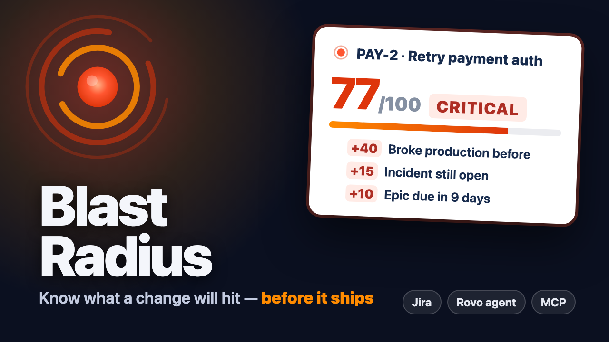

# Blast Radius

**See what a change will hit before it ships.** A Forge app for Jira: open any work
item and Blast Radius traces what it touches — linked services and repositories,
incidents that broke the same surface before, work that depends on it, concurrent
changes, the epic it could derail — scores the risk 0–100 with every point explained,
and tells you exactly who to loop in.

[](https://www.youtube.com/watch?v=9s7_xCw2VzU)

▶ **[Watch the demo (2½ min)](https://www.youtube.com/watch?v=9s7_xCw2VzU)**

Codegeist category: **Apps for Software Teams**.

## Where it shows up

| Surface | Module | What it does |
|---|---|---|
| Jira issue panel | `jira:issuePanel` | Risk score, factors, incidents, dependents, people, "Post as comment" |
| Rovo agent | `rovo:agent` | "What's the blast radius of this issue?" in chat, grounded in the actions below |
| Rovo actions | `action` ×4 | `analyze-blast-radius`, `find-related-incidents`, `who-to-notify`, `post-blast-radius-comment` |
| MCP server | `rovo:mcp` | The three read actions as MCP tools for Rovo Studio agents and external MCP clients |
| Teamwork Graph | `requestTeamworkGraph` | work item → PRs → repositories → services → JSM incidents, deployments, PR reviewers |

Bonus prizes this targets: **Best Agents**, **Best app with Atlassian MCP**, **Best
Teamwork Graph integration** (+ Marketplace if we submit a listing).

## How the score works

`src/core/analyze.js` is pure and unit-tested. Each factor is capped and carries its
own explanation:

| Factor | Max | Signal |
|---|---|---|
| Incident history on this surface | 40 | Σ severity × recency (e^-days/120) × overlap breadth |
| Open incident on the same surface | 20 | 15 each |
| Work that depends on this | 15 | open "blocks"-type links, 5 each |
| Parent epic at risk | 15 | due ≤21d, overdue, or Highest/High priority |
| Surface breadth | 15 | services + components + repos beyond the first |
| Concurrent changes | 10 | in-progress siblings sharing a component/label |
| Recent failed deployments | 10 | from the graph |

Levels: <25 low · <50 medium · <75 high · else critical.

## Data sources

- **Jira/JSM REST** (always on): issue, parent chain, links, siblings under the same
  epic, incidents (any work type matching `/incident/i`, last 365 days) that share a
  component or label, component leads.
- **Teamwork Graph** (when the app is allowlisted): Cypher in `src/core/sources/twg.js`.
  If the graph call fails for any reason the panel shows "Jira data only" and a
  warning instead of breaking.

## Setup

Requires Node 22 (`nvm use 22`) and the Forge CLI (`npm i -g @forge/cli`).

```bash
forge login                 # your Atlassian account + API token
forge register blast-radius # writes the real app id into manifest.yml
npm install
forge deploy
forge install --product jira --site <your-site>.atlassian.net
```

Teamwork Graph only runs *persisted* Cypher for apps. Register the queries once
(you must be a contributor on the app), wait ~1 minute, then redeploy:

```bash
JIRA_SITE=https://<site>.atlassian.net JIRA_EMAIL=<you> JIRA_API_TOKEN=<token> npm run register-queries
forge deploy
```

Until the keys exist, the panel runs on Jira data and says so.

### Demo data

Create a company-managed software project `PAY` and a JSM project `INC` (IT service
management template) on a test site, then:

```bash
JIRA_SITE=https://<site>.atlassian.net JIRA_EMAIL=<you> JIRA_API_TOKEN=<token> npm run seed
```

This builds the story the demo walks through: a retry change on the payments gateway,
two related incidents (one still open), a blocked downstream ticket, a sibling
refactor on the same component, an epic due in 10 days — and a docs typo fix as the
low-risk contrast.

## Tests

```bash
npm test
```

## Not yet verified on a live site

- Persisted queries are registered (keys in `src/core/queryKeys.js`), but executing
  them returns "User is not permitted to query this organization": the org still
  needs Teamwork Graph API access (Atlassian EAP/Preview form). Repositories are traversed but not returned: they are
  third-party nodes, and `graph_entity_replicates_3p_entity` is not available to apps.
- No GitHub/Bitbucket is connected to the test site yet, so the graph returns no PRs
  or services; incidents still come from Jira.
- JSM incidents have no Teamwork Graph scope listed yet; incidents reached via services
  may need one once allowlisted.
